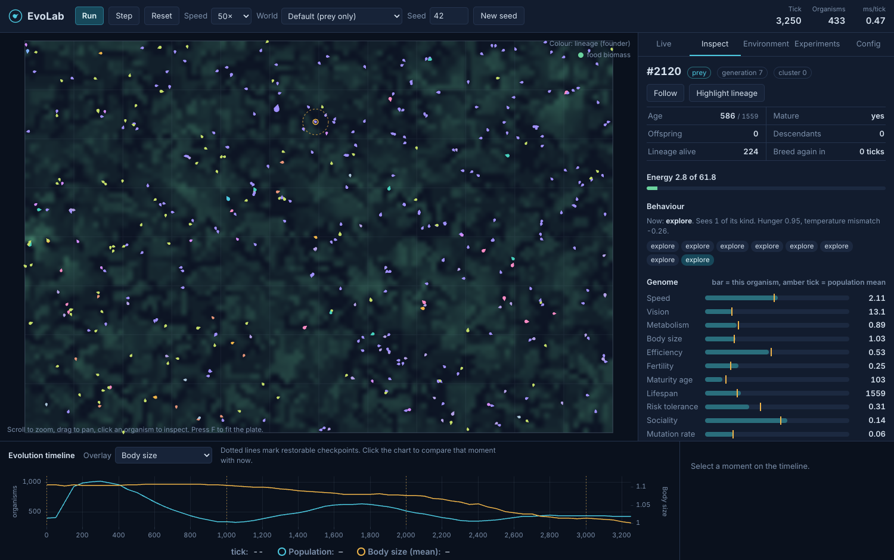
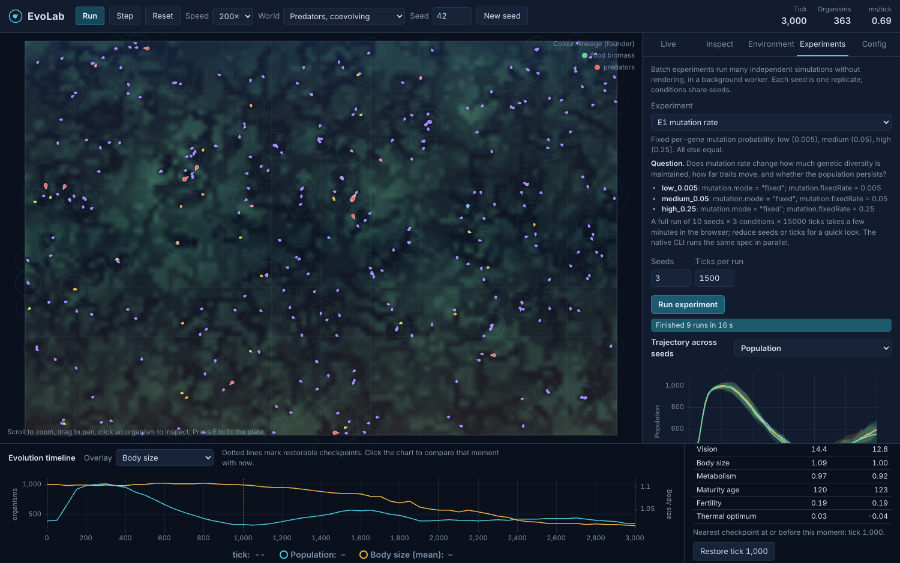

# EvoLab: an artificial-life evolution laboratory

Virtual organisms with heritable genomes live on a 2D "culture plate", sense
their surroundings, forage, flee, hunt, mate and die. Nothing about which traits
should win is written into the code: speed, vision, body size, life history,
caution, sociality, thermal tolerance and even the decision policy itself
evolve from differences in survival and reproduction.

* **Engine:** C++20, deterministic, no runtime dependencies, about 5,500 lines.
* **Browser lab:** the same engine compiled to WebAssembly, with a TypeScript/Vite
  dashboard for watching, inspecting and perturbing a live population.
* **Experiment runner:** headless multi-seed batches with CSV output, 95%
  confidence intervals and effect sizes, from the command line or the browser.



Native and browser builds produce bit-identical simulations: a config and seed
shared from the browser reproduces exactly in the command-line runner.

**Try it:** https://evolution-simulator.combio-worker.workers.dev (runs entirely
in your browser; no server, no account).

## Contents

- [Quick start](#quick-start)
- [Requirements](#requirements)
- [Building](#building)
- [Deploying](#deploying)
- [Command-line use](#command-line-use)
- [The browser lab](#the-browser-lab)
- [Configuration](#configuration)
- [Experiments and results](#experiments-and-results)
- [Testing](#testing)
- [Performance](#performance)
- [Reproducibility](#reproducibility)
- [Project layout](#project-layout)
- [Troubleshooting](#troubleshooting)
- [Known limitations](#known-limitations)

Further reading: [architecture](docs/ARCHITECTURE.md),
[simulation model](docs/SIMULATION_MODEL.md) (every formula),
[genetics](docs/GENETICS.md), [experiments and findings](docs/EXPERIMENTS.md).

## Quick start

```bash
# Native engine, tests and CLI
cmake -S . -B build -DCMAKE_BUILD_TYPE=Release
cmake --build build -j 4
ctest --test-dir build                     # or: build/evosim_tests
build/evosim run --ticks 10000             # watch a population evolve in the terminal

# Browser lab (needs Emscripten)
emcmake cmake -S . -B build-wasm -DCMAKE_BUILD_TYPE=Release
cmake --build build-wasm -j 4              # or, without CMake: node scripts/build_wasm.mjs
cd web && npm ci && npm run dev            # open http://localhost:5173
npm run build && npm run test:e2e          # production build + browser tests
```

On Windows, see [Windows without installing anything system-wide](#windows-without-installing-anything-system-wide).

## Requirements

| Tool | Verified with | Notes |
|---|---|---|
| C++ compiler | GCC 13.3 on Linux (glibc) and on Windows (MinGW-w64 UCRT, WinLibs build); Clang 15 | C++20; MSVC 2022 should work but is untested |
| CMake | 3.28 (Linux), 3.31 (Windows); needs ≥ 3.20 | |
| Git | any | CMake fetches Catch2 v3.5.4 for the tests |
| Emscripten | 3.1.6 (Linux), 3.1.74 (Windows) | browser build only; Ubuntu `apt install emscripten`, or [emsdk](https://emscripten.org/docs/getting_started/downloads.html) |
| Node.js | 22 and 24 (needs ≥ 18) | browser build, determinism check, end-to-end tests |
| Chrome, Chromium or Edge | any recent | end-to-end browser tests only (`npm run test:e2e`) |
| Python 3 + numpy/scipy | 3.12, scipy 1.18 | optional: `scripts/audit_results.py` |
| Python 3 + matplotlib | 3.12 / 3.11 | optional: `scripts/plot_results.py` and `scripts/sweep_predators.py` |

The engine deliberately avoids C++20 library features that older libc++
versions lack (for example `std::ranges` algorithms), so it builds with the
Emscripten that Ubuntu 24.04 ships.

### Windows without installing anything system-wide

Every tool can live in a gitignored `.tools/` folder inside the repository
(about 2 GB in all). This is how the Windows results in this README were
produced:

```bash
mkdir .tools && cd .tools
# Python (embeddable), only if you have none
curl -LO https://www.python.org/ftp/python/3.12.7/python-3.12.7-embed-amd64.zip && unzip python-3.12.7-embed-amd64.zip -d python
# GCC 13.3 (MinGW-w64, includes ninja) and CMake 3.31
curl -LO https://github.com/brechtsanders/winlibs_mingw/releases/download/13.3.0posix-11.0.1-ucrt-r1/winlibs-x86_64-posix-seh-gcc-13.3.0-mingw-w64ucrt-11.0.1-r1.zip
curl -LO https://github.com/Kitware/CMake/releases/download/v3.31.6/cmake-3.31.6-windows-x86_64.zip
unzip winlibs-*.zip && unzip cmake-*.zip
# Emscripten (browser build)
git clone --depth 1 https://github.com/emscripten-core/emsdk.git
python/python.exe emsdk/emsdk.py install 3.1.74 && python/python.exe emsdk/emsdk.py activate 3.1.74
cd ..
export PATH="$PWD/.tools/mingw64/bin:$PWD/.tools/cmake-3.31.6-windows-x86_64/bin:$PATH"   # Git Bash
```

The native build then uses `-G Ninja` (see below), and `node scripts/build_wasm.mjs`
finds `.tools/emsdk` on its own. The MinGW runtime DLLs are in
`.tools/mingw64/bin`, so keep that directory on `PATH` when running
`build/evosim.exe`.

## Building

### Native

```bash
cmake -S . -B build -DCMAKE_BUILD_TYPE=Release
cmake --build build -j 4
# Windows with the .tools toolchain above:
cmake -S . -B build -G Ninja -DCMAKE_BUILD_TYPE=Release -DCMAKE_CXX_COMPILER=g++
```

Produces `build/evosim` (CLI), `build/evosim_tests` (test suite) and the
`evosim_core` static library. Options:

| Option | Default | |
|---|---|---|
| `EVOSIM_BUILD_TESTS` | ON | fetch Catch2 and build the tests |
| `EVOSIM_BUILD_CLI` | ON | build `evosim` |
| `EVOSIM_SANITIZE` | OFF | AddressSanitizer + UndefinedBehaviorSanitizer |

### WebAssembly

```bash
emcmake cmake -S . -B build-wasm -DCMAKE_BUILD_TYPE=Release
cmake --build build-wasm -j 4
```

Produces `build-wasm/evosim.mjs` (an ES module, ~90 KB) and
`build-wasm/evosim.wasm` (~640 KB). Tests and the CLI are skipped for this target.

### Browser app

```bash
cd web
npm ci              # installs Vite, TypeScript and uPlot (pinned in package-lock.json)
npm run dev         # development server at http://localhost:5173
npm run build       # type-checks and writes the production site to web/dist/
npm run preview     # serves web/dist at http://localhost:4173
```

`npm run dev` and `npm run build` first run `npm run sync`, which copies the
compiled engine from `build-wasm/` and the shared presets from `config/` into
`web/public/`. Set `EVOSIM_WASM_DIR` to use a different build directory.

**Without CMake:** `node scripts/build_wasm.mjs` (or `npm run build:wasm` from
`web/`) compiles the engine with the same flags as the CMake WebAssembly target.
It uses the Emscripten SDK in `$EMSDK`, or the local one in `.tools/emsdk`.

URL options: `?autostart=1` starts running immediately (`?autostart=0` never
does), `?intro=0` skips the first-visit introduction, and `?ui=N` sets the
interface refresh interval in milliseconds (default 250; it never affects the
simulation).

**The site must be served over HTTP**: browsers will not load WebAssembly from a
`file://` page. `web/dist/` is a static site with relative paths, so any static
server works (`npm run preview`, `python3 -m http.server -d web/dist`, nginx, or
GitHub Pages).

## Deploying

The browser lab needs no backend: the simulation runs in the visitor's browser,
so the whole site is the static `web/dist/` folder (about 0.9 MB, 0.3 MB
compressed). It is deployed free, without a payment card, on **Cloudflare
Workers static assets**, configured in `web/wrangler.jsonc`:

```bash
cd web
npx wrangler login     # once per machine (opens the browser)
npm run deploy         # npm run build (type-check, sync engine + presets, bundle), then wrangler deploy
npm run test:e2e -- --url https://<your-worker>.workers.dev/   # optional: run the browser tests against it
```

`npm run deploy` deploys whatever `build-wasm/` contains, so rebuild the engine
first after changing C++ code (`npm run build:wasm`). The engine binary is not
committed; any host that can serve static files works too (GitHub Pages,
Netlify, Vercel), provided it serves `.wasm` as `application/wasm`. Note that
`wrangler pages project create` now hands over to Workers and fails without a
config file, which is why Workers static assets are used directly.

## Command-line use

```bash
build/evosim run --ticks 20000 --print-every 2000
build/evosim run --config config/predator_prey.json --seed 7 --csv out.csv --checkpoint run.evockpt
build/evosim run --resume run.evockpt --ticks 5000          # continue exactly where it stopped
build/evosim run --set "reproduction.mode=sexual,mutation.mode=fixed,mutation.fixedRate=0.1"
build/evosim experiment config/experiments/e1_mutation_rate.json --jobs 4 --out results/e1
build/evosim bench --sizes 500,2000,10000 --ticks 200      # timing + per-phase profile
build/evosim hash --ticks 1000 --every 100                 # state hashes for determinism checks
build/evosim validate my_config.json
build/evosim genes                                         # gene table from the engine
build/evosim default-config > my_config.json
```

Example `run` output (default config, seed 42):

```
tick       0 | pop   400 (prey   400, pred    0) | gen   0.0 max    0 | div 0.085 | food 0.80 | speed 1.21 vision 17.3 size 1.11 maturity   121
tick   10000 | pop   469 (prey   469, pred    0) | gen  20.2 max   29 | div 0.116 | food 0.07 | speed 2.43 vision 11.0 size 0.66 maturity   136
```

`--csv` writes one row per sample: population, births and deaths by cause,
lifespan, generation, diversity, food, clusters, lineages, and the mean, SD and
predator mean of every gene.

## The browser lab

* **First visit:** a short introduction explains organisms, food, genetic traits
  and evolution, with a **Start evolution** button (and an option to start
  automatically next time; the "?" button reopens it). While paused, a bar on the
  plate says so and offers Start or Resume, and a one-line summary above the
  plate states the current situation (population, lineages, generation, food).
* **Plate:** food biomass glows green; organisms are teardrops pointing where they
  are heading, sized by body and coloured by lineage, genetic cluster, energy or
  generation. Predators are red. Scroll or pinch to zoom, drag to pan, F or
  "Fit plate" to fit. On phones the plate takes the world's aspect ratio and the
  secondary controls fold under **Settings**.
* **Controls:** run, pause (Space), single-step (.), reset, speed from 1 to 200
  ticks per frame or "Max", world presets, seed.
* **Notifications:** extinction, a population halving and recovering, predators
  arriving or dying out, and newly detected genetic clusters appear as dismissible
  notes and in an "Observed in this run" log with their ticks. They are computed
  from statistics the engine already produced and cannot affect the simulation.
* **Live tab:** population, births and deaths, energy, lifespan, generations,
  diversity, food (each with an explanation of what it measures); trait change
  since tick 0 in units of the starting spread, next to a clearly labelled note
  on what a single run can and cannot show; population, trait-mean ± SD and
  diversity charts; a live
  histogram of any gene; a lineage plot showing each founder's share of the
  population over time (click a band to highlight that lineage on the plate);
  genetic clusters; the full energy budget.
* **Inspect tab:** click any organism to see its genome against the population
  mean, expressed phenotype, what it currently perceives, its last eight
  actions, parents, ancestors, children and descendant count. Follow it with the
  camera or highlight its lineage. Dead ancestors remain inspectable.
* **Environment tab:** change food capacity, regrowth and temperature, place
  hazards or deplete an area by clicking on the plate, relocate food patches,
  introduce predators, cull at random. Layers for food, temperature, hazards,
  vision radii and grid. Every change is logged and recorded in the config.
* **Experiments tab:** run any shipped experiment in a background Web Worker,
  with progress and estimated time left, then compare conditions: trajectories
  with 95% CI bands, an outcome table with Cohen's d and Welch p, and CSV/JSON
  downloads.
* **Config tab:** edit and validate the JSON config (all errors reported at
  once), download or load configs, download or load complete checkpoints.
* **Timeline:** population and any gene over the whole run on two axes. Click a
  moment to compare it with now. The app keeps automatic in-memory checkpoints
  (every 1,000 ticks by default, marked as dotted lines); restoring one rolls the
  complete state back exactly, and running again branches from there. Moments
  without a checkpoint can be inspected but not restored.



## Configuration

Configs are JSON with a format `version` (currently 1). Every field is optional
(defaults apply), unknown keys are rejected, and validation lists every problem
at once:

```
$ build/evosim validate bad.json
error: invalid configuration:
  - resources.capacty: unknown key
  - world.width must be in [20, 20000]
```

Sections: `world`, `population` (initial size, cap, per-gene founder ranges,
locked genes, founder groups), `resources`, `organisms` (energetics and
perception), `reproduction`, `mutation`, `controller`, `predators`,
`environment` (temperature, hazards, scheduled events) and `analytics`.
`build/evosim default-config` prints all keys with their defaults;
[SIMULATION_MODEL.md](docs/SIMULATION_MODEL.md) explains what each one does.

Presets in `config/`:

| Preset | |
|---|---|
| `default.json` | prey only, patchy food, mild temperature gradient |
| `predator_prey.json` | predators introduced at tick 1,500, everything evolves |
| `predator_prey_ecology.json` | same, with prey speed fixed (shows predator–prey oscillations) |
| `sexual.json` | sexual reproduction with mate choice by genome compatibility |
| `neural.json` | evolved neural-network controllers from random weights |
| `climate_shift.json` | warming and a hazard at tick 8,000, famine at 16,000, recovery at 24,000 |
| `thermal_niches.json` | larger world with a steep temperature gradient and sexual reproduction |

## Experiments and results

Seven experiments ship in `config/experiments/`, each with 10 seeds per
condition. Their complete outputs (raw per-run CSVs, per-sample trajectories,
summaries, figures) are in `results/`, and
[docs/EXPERIMENTS.md](docs/EXPERIMENTS.md) reports what happened, separating what
was measured from how it might be explained. Highlights (measured, 10 seeds per
condition; the explanations in brackets are interpretations):

* **Mutation rate:** a 50-fold higher rate doubled genetic diversity (d = 8.4)
  and traits moved further; the share of organisms that ever reproduced fell
  from 53% to 47% (consistent with mutational load).
* **Predation:** prey matured earlier under predation (153 → 111 and 100 ticks;
  the classic life-history response to extrinsic mortality). When prey could
  evolve escape speed, predators died out in 10/10 runs; with prey speed fixed,
  predators persisted in 4/10, and prey ended with larger eyes and bodies,
  higher sociality and lower risk tolerance.
* **Resources:** uniform food ended with short sight (vision ≈ 8) and patchy
  food with long sight (≈ 13); relocating patches produced the fastest organisms.
* **Vision:** populations locked at short sight were the largest, yet freely
  evolving vision settled near 13 (selection acts on competing individuals, not
  on population size).
* **Climate:** after a +1.0 temperature shift the thermal optimum gene rose to
  0.86 and 8/10 populations recovered; under fast oscillation it stayed at the
  long-run average.

Every number quoted in EXPERIMENTS.md is re-derived from the raw `runs.csv` /
`timeseries.csv` by `scripts/audit_results.py`, which also recomputes every
statistic in `summary.json` with scipy; its report is
[docs/RESULTS_AUDIT.md](docs/RESULTS_AUDIT.md).

Reproduce everything:

```bash
scripts/run_all_experiments.sh 4        # jobs; ~12 minutes on 2 cores
python3 scripts/plot_results.py         # results/<experiment>/figure.png
python3 scripts/audit_results.py --repro build/repro   # after re-running into build/repro/<experiment>
```

## Testing

```bash
ctest --test-dir build --output-on-failure
build/evosim_tests "[property]"         # run one group: json, config, genome, mutation, spatial,
                                        # resources, simulation, energy, property, sanity,
                                        # checkpoint, experiment, stats, detmath
```

52 test cases with about 58 million assertions (the property tests check every
invariant after every tick):

* **Unit:** JSON parsing and round-trips; config validation and messages; gene
  ranges; mutation probability, unbiasedness and spread; crossover; genome
  distance as a metric; phenotype trade-offs; resource regrowth, depletion and
  decay; temperature and hazards; spatial grid against brute force; statistics
  helpers against reference values; deterministic math against libm.
* **Integration:** determinism across all modes; analytics never perturbing the
  trajectory; the energy ledger balancing to 1e-9 in six scenarios; lineage
  bookkeeping; predation; interactive events replaying from config; perception
  limited to vision; population cap; scheduled patch relocation; multi-seed
  experiments (serial and parallel give identical results); CSV output.
* **Property-based:** 12 randomised configurations checked after every tick: no
  invalid trait, energy within bounds, positions inside the world, population
  counts matching, every child referencing valid parents with the right
  generation and founder, and no birth at or after a parent's death.
* **Scientific sanity:** no regrowth leads to extinction; no food means nobody
  survives; no reproduction means no births; incompatible mates produce no
  offspring; zero mutation preserves founder genomes exactly; a temperature shift
  raises thermal costs; predation depends on its parameters. None assert which
  trait should evolve.
* **Checkpoints:** save, resume and continue is bit-identical to an
  uninterrupted run, including interactive events; corrupt, truncated and
  future-version files are rejected with clear messages.

The suite passed under AddressSanitizer and UBSan (`-DEVOSIM_SANITIZE=ON`) on
Linux; that configuration has not been re-run on Windows, where MinGW does not
ship the sanitizer runtimes.

### End-to-end browser tests

`web/e2e/e2e.mjs` serves the production build, drives it in a local Chrome,
Chromium or Edge (via `puppeteer-core`; set `CHROME_PATH` if it is not found),
and checks every state it reaches against an independent copy of the same
WebAssembly engine running in Node:

```bash
cd web
npm run build && npm run test:e2e
```

It covers the first-visit introduction and auto-start; pause, resume, step and
reset (reset must reproduce the initial state hash); the live trajectory matching
the reference engine; clicking an organism to inspect it; environment changes
being applied, logged, recorded in the config and replayed exactly from it;
restoring a timeline checkpoint to the exact saved state; running an experiment
in the worker; running at UI refresh intervals of 16 ms and 2 s and at different
speeds without changing the trajectory or the population observations; and the
layout at 390, 768 and 1440 px (no horizontal scroll, whole plate visible,
legend and hints clear of it, phone controls reachable). Any console error or
failed request fails the run.

### Verified status

Last verified on Windows 11 (x86-64):

| Check | Command | Result |
|---|---|---|
| Native build | `cmake --build build` (GCC 13.3 MinGW-w64, CMake 3.31, Ninja) | no warnings |
| Native test suite | `build/evosim_tests` | 52 test cases, 58,291,796 assertions, all passed |
| Native vs WebAssembly | `node scripts/compare_native_wasm.mjs --native build/evosim.exe --ticks 3000 --every 50 --config <preset>` | identical at all 60 checkpoints for all 7 presets |
| Browser, production build | `npm run test:e2e` | 12/12 passed, no console errors or failed requests |
| Native test suite via CTest | `ctest --test-dir build -j 8` | 52/52 passed |
| Experiment re-run | `evosim experiment config/experiments/<e>.json --jobs 14 --out build/repro/<e>` × 7 (9 min on 16 threads) | all 220 runs and all trajectories identical to `results/` (ms_per_tick excluded) |
| Results audit | `python scripts/audit_results.py --repro build/repro --out docs/RESULTS_AUDIT.md` | 182 checks passed; 147 documented numbers and claims confirmed after the corrections listed in [EXPERIMENTS.md](docs/EXPERIMENTS.md#corrections) |

## Performance

`build/evosim bench` keeps organism density constant and scales the world with
the population. Single thread, GCC 13 `-O3`, on the 2-core cloud VM used for
development:

| Organisms | ms per tick | ticks per second | sense + decide | feed | regrow | spatial index |
|---:|---:|---:|---:|---:|---:|---:|
| 500 | 0.61 | 1,633 | 84% | 7% | 4% | 2% |
| 1,000 | 1.20 | 835 | 82% | 9% | 4% | 2% |
| 2,000 | 2.34 | 427 | 81% | 9% | 4% | 2% |
| 5,000 | 6.01 | 167 | 77% | 12% | 4% | 3% |
| 10,000 | 13.7 | 73 | 73% | 13% | 6% | 3% |
| 20,000 | 30.6 | 33 | 72% | 13% | 7% | 3% |
| 40,000 | 67.2 | 15 | 71% | 13% | 7% | 3% |

Cost grows linearly (about 1.2–1.7 µs per organism per tick) thanks to the
uniform-grid spatial index. With predators enabled, timings are within a few
percent; the neural controller costs about 1.6× more. The WebAssembly build
runs at about 1.2–1.4× native time (0.85 ms per tick for 500 organisms in
Node 22), so the browser handles a few thousand organisms at interactive speed.
Perception dominates every profile, so that is where any further optimisation
should go; see [ARCHITECTURE.md](docs/ARCHITECTURE.md).

## Reproducibility

* Same engine version + config + seed ⇒ the same trajectory, every time.
* **Native and browser builds match bit for bit.** All randomness comes from one
  `std::mt19937_64` with hand-written distributions, state-affecting `exp`,
  `log`, `pow`, `sin` and `tanh` use the engine's own IEEE-754 implementations,
  and FMA contraction is disabled. Check it yourself:

  ```bash
  node scripts/compare_native_wasm.mjs --ticks 3000 --every 50 --config config/predator_prey.json
  # IDENTICAL  config/predator_prey.json: native and WASM state hashes match at all 60 checkpoints through tick 3000
  ```

  Verified for GCC 13/glibc on x86-64 Linux against Clang 15/musl on WebAssembly
  (Emscripten 3.1.6), and for GCC 13.3/MinGW-w64 on x86-64 Windows against
  Emscripten 3.1.74, on all seven presets. Other compilers and CPUs should match
  by construction but are untested. On Windows pass `--native build/evosim.exe`.
* The browser's own trajectory is checked against a separate engine instance by
  the end-to-end tests, including after pausing at arbitrary ticks, restoring
  checkpoints and replaying recorded interactive changes.
* Live changes made in the browser are recorded in the config with their tick,
  so a downloaded config plus seed replays the interactive session.
* Checkpoints store the complete state (including the RNG, lineage and
  statistics) and record the engine version; loading a checkpoint from a
  different engine version is refused with an explanation.
* Statistics and clustering never draw random numbers, so changing how often you
  measure never changes what happens. The browser's notifications only read
  statistics already copied out of the engine; the end-to-end tests confirm that
  different UI refresh rates give identical state hashes and observations.

## Project layout

```
CMakeLists.txt
apps/evosim_cli.cpp            command-line tool
src/core/                      Simulation (tick phases), config, JSON, RNG, deterministic math, spatial grid
src/organisms/                 genome, phenotype, organism record, controllers (utility, neural)
src/ecology/                   resource field, environment (temperature, hazards)
src/analytics/                 statistics, lineage tracker, genetic clusters, stats maths, experiment runner
src/serialization/             binary versioned checkpoints
src/interfaces/wasm_api.cpp    C ABI exported to JavaScript
tests/                         Catch2 suite
config/                        presets and config/experiments/*.json
results/                       outputs of the seven experiments (CSV, JSON, Markdown, figures)
web/                           Vite + TypeScript dashboard (src/, scripts/sync-assets.mjs), e2e/ browser tests,
                               wrangler.jsonc (deployment)
scripts/                       run_all_experiments.sh, plot_results.py, compare_native_wasm.mjs, sweep_predators.py,
                               build_wasm.mjs (engine without CMake), audit_results.py (results audit)
docs/                          architecture, model, genetics, experiments, results audit
.tools/                        optional local toolchain (gitignored, never committed)
```

## Troubleshooting

| Symptom | Fix |
|---|---|
| Build runs for many minutes or the machine stalls | Give `-j` a number (`-j 4`, or the number of cores). A bare `-j` lets Make start unlimited compilers at once, which can exhaust memory on small machines. |
| CMake cannot download Catch2 | Configure with `-DEVOSIM_BUILD_TESTS=OFF`, or point `-DFETCHCONTENT_SOURCE_DIR_CATCH2=/path/to/Catch2` at a local checkout. |
| `npm run dev` says `Missing build-wasm/evosim.mjs` | Build the WebAssembly target first (see above), or set `EVOSIM_WASM_DIR`. |
| Blank page, "failed to fetch" or a MIME error for `.wasm` | Serve over HTTP (`npm run preview`), not from `file://`. The server must send `.wasm` as `application/wasm`. |
| Emscripten errors about `std::ranges` or other C++20 library features | Your libc++ is old (as in Emscripten 3.1.x). The engine avoids these; if you extend it, do too or use a newer emsdk. |
| The app's font looks plain | The UI loads Instrument Sans from Google Fonts and falls back to the system font offline. |
| `node scripts/compare_native_wasm.mjs` fails with an ambiguous-module error | Use Node ≥ 18; the script provides the CommonJS shims that Emscripten 3.1's ES6 output needs under Node. |
| Population goes extinct immediately after editing the config | Usually costs exceed food supply. Check the energy budget in the Live tab and compare with the defaults (`evosim default-config`). |
| Browser experiments are slow | Lower seeds or ticks in the Experiments tab, or run the same spec with the native CLI and `--jobs`. |
| `build/evosim.exe` exits silently or reports a missing `libstdc++-6.dll` (Windows) | Put the compiler's `bin` directory (e.g. `.tools/mingw64/bin`) on `PATH`. |
| `npm run test:e2e` says "No Chrome found" | Install Chrome, Chromium or Edge, or set `CHROME_PATH` to its executable. |
| `node scripts/build_wasm.mjs` fails with "Python was not found" (Windows) | It needs the Python that emsdk installs; run `emsdk install` and `emsdk activate` as shown under Requirements. |
| Headless screenshots of the phone layout look clipped | Chrome's `--window-size` has a minimum width of about 500 px; use a device viewport (as the e2e tests do) instead. |

## Known limitations

* **Predator–prey coexistence is fragile.** With everything evolving, prey
  out-evolve predators in the default world (predators died out in 10/10 runs of
  E4). Coexistence and oscillations occur when prey speed is fixed (the
  `predator_prey_ecology` preset), and `scripts/sweep_predators.py` maps the
  parameter space. This is a property of the model, documented rather than
  tuned away.
* **Body size often reaches its lower bound** (0.5) under scarcity without
  predators; such results mean "as small as the model allows" (see
  [SIMULATION_MODEL.md §8](docs/SIMULATION_MODEL.md#8-simplifying-assumptions-and-what-they-imply)).
* **Default populations are small** (hundreds), so drift is strong and single
  runs vary a lot. Draw conclusions from multi-seed experiments.
* **Genetic clusters are not species**; the speciation module measures genomic
  divergence only.
* **Browser rollback** uses in-memory checkpoints (up to 24 per session); they
  are lost on reload unless downloaded from the Config tab.
* **The lineage log** keeps up to 3 million records (configurable). Beyond that
  it stops recording rather than corrupt ids, and the app reports it.
* **Multithreading:** the engine is single-threaded by design (determinism
  first); batch experiments are parallel across seeds instead.
* **Cluster notifications** are checked whenever the interface refreshes, so the
  tick at which a new genetic cluster is announced (not whether the simulation
  changes) can differ slightly with the refresh rate. Population notifications
  use the engine's own sample ticks and do not vary.
* **p-values are not corrected for multiple comparisons**; each experiment
  reports 15–30 metrics, so treat isolated p ≈ 0.01–0.05 results with caution.
