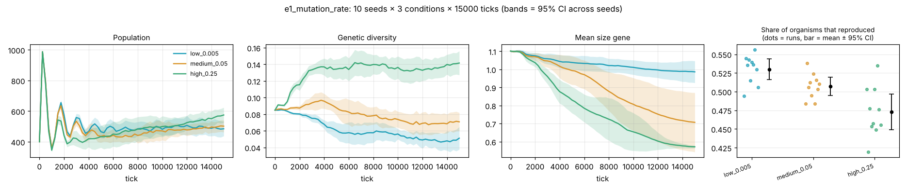
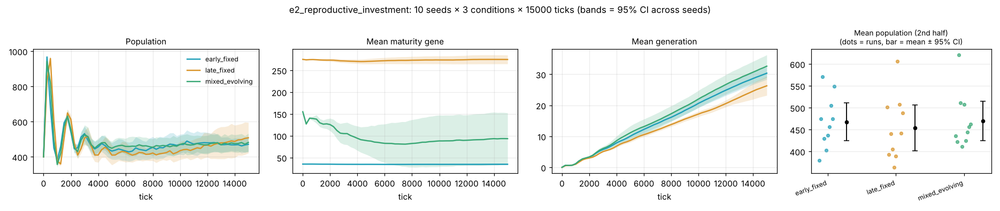
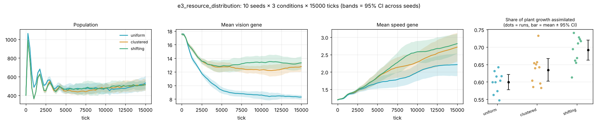
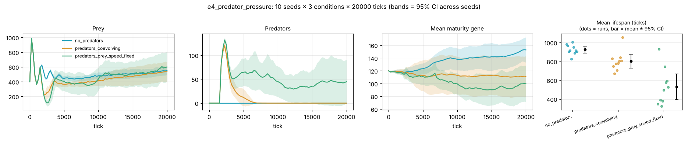
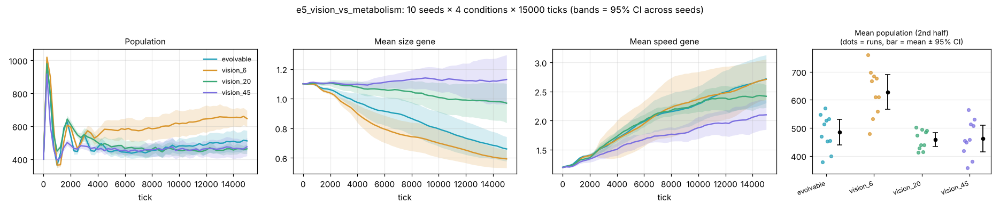
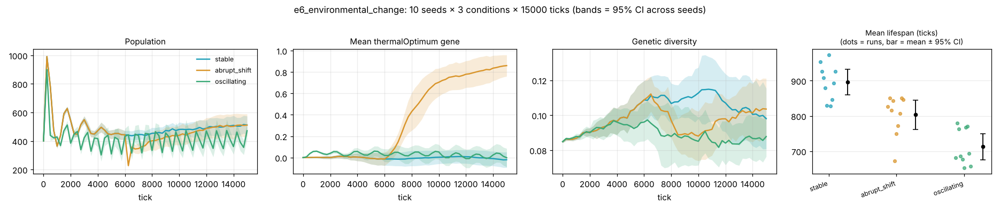
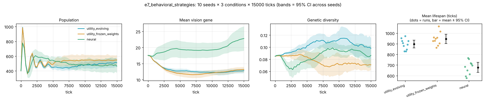

# Experiments

The experiment runner (`evosim experiment`) executes many independent simulations
without rendering and compares conditions statistically. This document explains
the method and reports the results of the seven shipped experiments. Every number
below comes from `results/<experiment>/` (raw per-run data in `runs.csv`), produced
by engine 1.0.0 with:

```bash
scripts/run_all_experiments.sh 2      # 2 parallel jobs; about 12 minutes on 2 cores
python3 scripts/plot_results.py       # results/<experiment>/figure.png
```

Rerunning these commands with the same engine reproduces the numbers exactly
(the runs are deterministic; only `ms_per_tick` varies with the machine).

## Method

* **Replicate = one simulation run.** Each condition is run with 10 seeds
  (1000–1009). Organisms within a run are never treated as independent samples.
* **Common random numbers.** Conditions share seeds, so differences between
  conditions are not confounded with different initial placements or patch
  layouts.
* **Controlled ecology.** Each condition changes only the overrides listed in its
  spec (`config/experiments/*.json`); everything else is `config/default.json`.
* **Statistics** (in `summary.csv` / `summary.md`): n, mean, SD, median, 95%
  t-interval of the mean, Cohen's d against the first (baseline) condition and
  Welch's t-test p-value. Extinction is a proportion and gets a Wilson 95%
  interval.
* **Trajectories** (`timeseries_summary.csv`, figures): mean across seeds at every
  sample with a 95% CI band. Extinct runs are padded with population 0.
* **Outcome metrics** (`runs.csv`): extinction and its tick, final and mean
  population (second half of the run), minimum population, predator outcome, mean
  and median lifespan and offspring per organism and the share that reproduced
  (over non-founder prey that died), total births, maximum generation, final and
  mean genetic diversity, mean food availability, share of plant growth
  assimilated, recovery time after a perturbation, final number of genetic
  clusters, compute cost per tick, and the final mean of every gene.

With 10 seeds the experiments have reasonable power for large effects
(|d| ≳ 1.3 at α = 0.05) but not for small ones. Each experiment reports roughly
15–30 metrics, so a few nominal p < 0.05 results are expected by chance; the
findings below emphasise effects that are large, consistent across seeds and
mechanistically interpretable. They describe this model, not nature. No
correction for multiple comparisons is applied to the p-values.

In each section, the table and the **Observed** paragraph report measured
outcomes. **Interpretation** offers explanations that are consistent with the
data but were not tested by a dedicated experiment. Every number in the tables
and the specific claims in the text are re-checked against the raw data by
`scripts/audit_results.py` (report: [RESULTS_AUDIT.md](RESULTS_AUDIT.md)).

## E1: mutation rate

`config/experiments/e1_mutation_rate.json`, 15,000 ticks, fixed per-gene mutation
probability 0.005 / 0.05 / 0.25.

| | low 0.005 | medium 0.05 | high 0.25 |
|---|---|---|---|
| extinct | 0/10 | 0/10 | 0/10 |
| mean population | 491 ± 67 | 476 ± 56 (d = −0.25, p = 0.59) | 517 ± 76 (d = 0.37, p = 0.42) |
| genetic diversity | 0.061 ± 0.007 | 0.080 ± 0.009 (d = 2.3) | 0.131 ± 0.009 (d = 8.4, p < 0.001) |
| share that reproduced | 0.530 ± 0.019 | 0.507 ± 0.017 (d = −1.3, p = 0.011) | 0.473 ± 0.034 (d = −2.1, p < 0.001) |
| final speed | 1.88 ± 0.31 | 2.79 ± 0.47 | 3.11 ± 0.31 (d = 3.9) |
| final body size | 0.99 ± 0.08 | 0.71 ± 0.23 | 0.57 ± 0.01 (d = −6.9) |
| plant growth assimilated | 0.60 ± 0.04 | 0.69 ± 0.08 | 0.76 ± 0.04 (d = 4.0) |

**Observed.** Higher mutation rates maintained far more standing variation and
the populations moved further through trait space in the same time, toward
small, fast bodies (final speed 1.88 → 3.11, body size 0.99 → 0.57 from the low
to the high rate). At the low rate traits still moved, but less far: mean speed
rose from 1.20 at tick 0 to 1.88, and vision fell from 17.5 to 11.5. The share of
organisms that ever reproduced fell from 53% to 47%. Population size did not
differ detectably, though the high-rate populations captured more of the plant
production.

**Interpretation.** Small, fast bodies appear to be the direction selection
favours under scarcity in this model (compare E3/E5), and higher mutation lets
populations get there faster; at the low rate the change mostly reflects
selection on the founders' initial variation. The lower breeding share is
consistent with **mutational load**, though this experiment does not isolate
that mechanism.



## E2: reproductive investment (early vs late maturity)

Maturity held at 30–40 ticks vs 250–300 ticks (gene locked), plus a mixed
population of both founder types with maturity free to evolve.

| | early, fixed | late, fixed | mixed, evolving |
|---|---|---|---|
| mean population | 468 ± 61 | 454 ± 73 (d = −0.21, p = 0.65) | 470 ± 63 |
| mean lifespan | 901 ± 52 | 955 ± 67 (d = 0.90, p = 0.06) | 920 ± 50 |
| max generation | 37.3 ± 2.5 | 31.8 ± 4.0 (d = −1.65, p = 0.002) | 40.2 ± 5.8 |
| final maturity | 34.6 | 275 | 93 ± 83 |

**Observed.** Locking maturity early or late made **no detectable difference to
population size**; late maturers lived somewhat longer (p = 0.06) and reached
fewer generations. When the two founder types competed, the outcome varied
between seeds: in 8 of 10 runs the final mean maturity ended close to the early
strategy (29–92 ticks), in 2 of 10 close to the late one (200 and 282 ticks).

**Interpretation.** Under resource limitation the longer lives of late maturers
seem to roughly compensate for their slower turnover. Early reproduction usually
won the competition, but not deterministically, a reminder that one run is an
anecdote. With 10 seeds a small population-size difference could still go
undetected.



## E3: resource distribution

Uniform food vs static Gaussian patches vs patches that relocate every 1,500
ticks. The uniform capacity (4.0 per cell) was chosen to roughly match the total:
38,400 energy units of capacity vs about 35,100 for the default patches (seed
1000), so uniform worlds have about 9% more food in total.

| | uniform | clustered | shifting |
|---|---|---|---|
| mean population | 482 ± 79 | 484 ± 64 | 492 ± 74 |
| final vision | 8.3 ± 0.5 | 12.8 ± 1.0 (d = 5.7, p < 0.001) | 13.3 ± 1.3 (d = 5.0, p < 0.001) |
| final speed | 2.21 ± 0.46 | 2.72 ± 0.58 (d = 1.0) | 2.82 ± 0.40 (d = 1.4, p = 0.005) |
| mean lifespan | 958 ± 65 | 896 ± 50 (d = −1.1) | 898 ± 54 (d = −1.0) |
| plant growth assimilated | 0.60 ± 0.03 | 0.63 ± 0.05 | 0.69 ± 0.04 (d = 2.6, p < 0.001) |

**Observed.** With uniform food **vision evolved down to about 8**; with patchy
food it ended around 13, and those populations were also faster. Patchy worlds
had shorter mean lifespans. The shifting world produced the fastest organisms
and the highest share of plant growth assimilated.

**Interpretation.** Where food is everywhere, seeing far is probably not worth
its maintenance cost; patches make long sight and speed pay because food must be
found across barren ground, which plausibly also explains the shorter lives.
Relocating patches repeatedly strands populations in empty regions, which would
favour mobility. These mechanisms are consistent with the data but were not
tested separately.



## E4: predator pressure

No predators vs coevolving predators (40 introduced at tick 1,500) vs predators
with prey speed held fixed. 20,000 ticks.

| | no predators | predators, coevolving | predators, prey speed fixed |
|---|---|---|---|
| prey extinct | 0/10 | 0/10 | 1/10 |
| predators extinct | n/a | **10/10** | 6/10 |
| mean prey lifespan | 925 ± 52 | 801 ± 104 (d = −1.5, p = 0.005) | 531 ± 192 (d = −2.8, p < 0.001) |
| final maturity | 153 ± 28 | 111 ± 44 (d = −1.1, p = 0.023) | 100 ± 37 (d = −1.6, p = 0.003) |
| final vision | 13.2 ± 0.9 | 13.4 ± 0.8 | 25.8 ± 15.0 (d = 1.2, p = 0.036) |
| final body size | 0.58 ± 0.04 | 0.67 ± 0.18 | 0.77 ± 0.22 (d = 1.2, p = 0.033) |
| final sociality | −0.27 ± 0.28 | −0.22 ± 0.34 | +0.06 ± 0.15 (d = 1.5, p = 0.006) |
| final risk tolerance | 0.52 ± 0.09 | 0.45 ± 0.13 | 0.37 ± 0.15 (d = −1.3, p = 0.020) |

**Observed** (the reasons offered are interpretation)**.**

* **Coevolving predators always lost.** After a boom on naive prey, predators
  declined and went extinct in every run: the earliest between 1,750 and 2,000
  ticks after introduction, the latest between 6,750 and 7,000 (the bounds are
  the last sample with predators and the first without; samples are 250 ticks
  apart). *Interpretation:* prey were free to evolve escape speed, and with a
  larger population and faster turnover they appear to out-evolve their
  predators in this model.
* **With prey speed fixed, predators persisted in 4/10 runs** (ending with 47–155
  predators) and once drove prey extinct. Prey under sustained predation ended
  with **larger vision** (25.8 vs 13.2), **larger bodies**, **higher sociality**,
  **lower risk tolerance** and **earlier maturity** than prey without predators.
  *Interpretation:* this resembles a textbook anti-predator suite (the model
  gives larger bodies and groups a defence against capture), but each trait's
  benefit was not tested separately.
* **Earlier maturity under predation** appeared in both predator conditions
  (153 → 111 → 100 ticks). *Interpretation:* this matches the classic
  life-history prediction that higher extrinsic mortality favours earlier
  reproduction; no rule in the code ties maturity to predation.

The browser's "Predators, prey speed fixed" preset shows the early predator–prey
oscillations live.



## E5: vision versus metabolism

Vision locked at 6, 20 or 45 (it costs `0.0008 × radius` energy per tick)
compared with freely evolving vision.

| | evolvable | vision 6 | vision 20 | vision 45 |
|---|---|---|---|---|
| mean population | 484 ± 64 | **628 ± 86** (d = 1.9, p < 0.001) | 458 ± 35 | 463 ± 66 |
| mean lifespan | 896 ± 50 | 962 ± 128 | 782 ± 37 (d = −2.6) | 743 ± 44 (d = −3.3) |
| plant growth assimilated | 0.63 ± 0.05 | 0.69 ± 0.05 (d = 1.1, p = 0.02) | 0.67 ± 0.07 | 0.63 ± 0.05 |
| final vision | 12.8 ± 1.0 | 6 | 20 | 45 |
| final body size | 0.66 ± 0.12 | 0.59 ± 0.08 | 0.97 ± 0.19 (d = 2.0) | 1.13 ± 0.23 (d = 2.6) |
| final metabolism | 0.82 ± 0.25 | 0.68 ± 0.11 | 0.85 ± 0.11 | 1.01 ± 0.12 (d = 1.0) |

**Observed.** The populations locked at vision 6 were **the largest** (628 vs
484). Yet where vision could evolve it did not fall to 6: it ended near 13.
Populations locked at vision 20 or 45 had shorter lives and evolved larger
bodies, and at 45 a higher metabolism.

**Interpretation.** Selection acts on individuals competing with each other, not
on population size: an individual that sees food a little sooner than its
neighbours can win even if everyone seeing further makes the population smaller
(a tragedy-of-the-commons pattern). Larger bodies (cheaper maintenance per unit
of stored energy in this model) and faster metabolism (more intake per
encounter) look like compensation for the cost of vision. Neither explanation
was tested by a dedicated experiment.



## E6: environmental change

Stable climate vs a single +1.0 temperature shift at tick 6,000 vs a climate
oscillating with amplitude 0.8 and period 1,500.

| | stable | abrupt shift | oscillating |
|---|---|---|---|
| mean population | 484 ± 64 | 462 ± 94 | 409 ± 75 (d = −1.1, p = 0.027) |
| mean lifespan | 896 ± 50 | 803 ± 57 (d = −1.7, p = 0.001) | 713 ± 51 (d = −3.6, p < 0.001) |
| final thermal optimum | −0.02 ± 0.10 | **0.86 ± 0.14** (d = 7.2, p < 0.001) | −0.00 ± 0.12 |
| final maturity | 142 ± 30 | 141 ± 33 | 98 ± 44 (d = −1.2, p = 0.019) |
| genetic diversity | 0.102 ± 0.011 | 0.097 ± 0.007 | 0.089 ± 0.009 (d = −1.3, p = 0.009) |

**Observed** (the reasons offered are interpretation)**.**

* After the abrupt shift, the **thermal optimum gene rose** from ≈0 to 0.86 (the
  shift was 1.0), i.e. populations tracked the new climate genetically. Eight of ten
  populations recovered to 90% of their pre-shift size (median ≈1,600 ticks; the
  recovery metric for the stable condition is only a noise baseline); two had not
  recovered 9,000 ticks later.
* Under continual oscillation the optimum stayed at the **long-run average** (≈0)
  rather than following the cycle, and those populations were smaller, shorter
  lived, matured earlier and had lower diversity. *Interpretation:* the cycle
  was probably too fast to track, and the costs reflect the constant mismatch.



## E7: behavioural strategies

Utility controller with evolving weights vs the same controller with behaviour
genes frozen at founder values vs an evolved neural network (random initial
weights), with identical ecology and seeds.

| | utility, evolving | utility, frozen weights | neural |
|---|---|---|---|
| extinct | 0/10 | 0/10 | 0/10 |
| mean population | 484 ± 64 | 543 ± 92 (d = 0.74, p = 0.12) | 480 ± 113 (d = −0.05) |
| mean lifespan | 896 ± 50 | 945 ± 60 | 677 ± 66 (d = −3.7, p < 0.001) |
| share that reproduced | 0.518 ± 0.017 | 0.515 ± 0.021 | 0.452 ± 0.040 (d = −2.2, p < 0.001) |
| final vision | 12.8 ± 1.0 | 13.1 ± 1.2 | 22.8 ± 5.3 (d = 2.6, p < 0.001) |
| final body size | 0.66 ± 0.12 | 0.67 ± 0.12 | 0.83 ± 0.11 (d = 1.5, p = 0.004) |

**Observed.** Starting from random weights, the neural populations persisted in
every run and reached the same population size as the hand-structured
controller, but with much **larger vision** and bodies, **shorter lives** and a
lower share of successful breeders. Freezing the utility weights did not reduce
population size (543 vs 484, p = 0.12).

**Interpretation.** The neural controllers appear to reach the same carrying
capacity by a faster, more wasteful life history. The frozen-weights result
suggests the founder weights were already adequate and evolving them mostly
added drift, but the difference is not significant either way.



## Corrections

An audit on 2026-10-18 (`scripts/audit_results.py`) re-derived every number in
this document from the raw data, and re-ran all seven experiments on a different
platform (GCC 13.3, MinGW-w64, Windows). The re-run reproduced every `runs.csv`
cell (except wall-clock `ms_per_tick`) and every `timeseries.csv` exactly, and
all statistics in `summary.json` matched scipy. These statements in the text were
corrected; none changes a conclusion:

* E1 final speed was 1.89 ± 0.31 and 2.80 ± 0.48; the data give 1.88 ± 0.31 and
  2.79 ± 0.47. E3 clustered vision d was 5.8 (data: 5.75 → 5.7). E5 vision 6:
  plant growth d was 1.2 (1.15 → 1.1) and body size SD 0.09 (0.085 → 0.08). These
  were rounding errors.
* E1 said that at the low mutation rate "trait means barely moved from the
  founders". They moved substantially (speed 1.20 → 1.88, vision 17.5 → 11.5),
  only less far than at higher rates.
* E4 gave predator extinction as "between 1,750 and 6,750 ticks after
  introduction", which are the last samples that still had predators; the
  extinctions happened 1,750–2,000 ticks after introduction at the earliest and
  6,750–7,000 at the latest.
* E6 gave the median recovery time as ≈1,500 ticks; it is 1,625.
* The "What happened" paragraphs were split into **Observed** and
  **Interpretation**, so that explanations are not presented as measurements.

## Running your own

```bash
# A spec is a JSON file: base config + named conditions of dotted-path overrides.
build/evosim experiment config/experiments/e3_resource_distribution.json --jobs 4 --out results/mine
build/evosim experiment my_spec.json --seeds 20 --ticks 30000      # override size
```

```json
{
  "name": "my_question",
  "description": "What is being compared.",
  "hypothesis": "The question in plain words.",
  "baseConfig": "../default.json",
  "ticks": 15000, "seeds": 10, "seedStart": 1000, "sampleInterval": 250,
  "recoveryAfterTick": -1,
  "conditions": [
    { "name": "control", "overrides": {} },
    { "name": "scarce", "overrides": { "resources.capacity": 8 } }
  ]
}
```

Every condition is validated before anything runs, so a typo in an override path
fails immediately with the offending key. The browser's Experiments tab runs the
same specs in a Web Worker and shows trajectories with confidence bands and an
outcome table with effect sizes.
